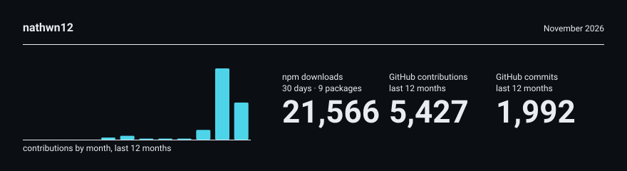

  

<h1 align="center">nathwn12</h1>

<strong>Backend developer with fintech experience: payments, data access, auth on AWS. Frontend too: React and Vue.</strong>

**Open to work** — backend, frontend, and platform roles, remote.

[Portfolio](https://nathwn12.github.io/) · [Resume](https://nathwn12.github.io/Nathaniel-Nikolai-Ladero-Resume.pdf) · [CV](https://nathwn12.github.io/Nathaniel-Nikolai-Ladero-CV.pdf) · [LinkedIn](https://www.linkedin.com/in/nathaniel-nikolai-l-184181261/) · [Email](mailto:nathanielnikolai.ladero@gmail.com)

## Work

Backend Developer, Xentra Infotech Solutions Inc., 2023-2026.

- Cut worst-case payment query latency from about 60 seconds to under one second, migrating payment services from MySql.Data to MySqlConnector on AWS.
- Reduced read latency by more than 40 percent with EF Core and Dapper, Redis caching, and index tuning against real query plans.
- Built authentication on JWT, OAuth 2.0, OpenID Connect, RBAC, and ABAC. Zero high or critical Snyk findings on production.
- 1,182 commits across 17 repositories.

## Published

**On npm** — nine packages, each installed on its own:

- [gladius-mcp](https://www.npmjs.com/package/gladius-mcp)
- [puppet-mcp](https://www.npmjs.com/package/puppet-mcp)
- [@nathwn12/janua](https://www.npmjs.com/package/@nathwn12/janua)
- [@nathwn12/oc-bifrost](https://www.npmjs.com/package/@nathwn12/oc-bifrost)
- [oc-flight-deck](https://www.npmjs.com/package/oc-flight-deck)
- [oc-harness-setup](https://www.npmjs.com/package/oc-harness-setup)
- [oc-plugin-view](https://www.npmjs.com/package/oc-plugin-view)
- [oc-talk](https://www.npmjs.com/package/oc-talk)
- [rea-shim](https://www.npmjs.com/package/rea-shim)

**Direct download:**

- [ArcInstaller](https://github.com/nathwn12/arc-installer/releases) — applies the ARC icon theme to Windows, restores the stock set on revert
- [sp2yt](https://github.com/nathwn12/spotify-playlist-to-youtube/releases) — copies a public Spotify playlist into YouTube Music
- [Chromium extensions](https://github.com/nathwn12/my-chromium-extensions/releases) — loudness target, slowed playback, Discord presences

## Numbers

Regenerated weekly from the npm registry and the GitHub API. No service in between.

  

## Projects

- [gladius](https://github.com/nathwn12/gladius) — Rust MCP server giving an agent headless Chrome over CDP. One binary, no Node, no Playwright.
- [puppet](https://github.com/nathwn12/puppet) — Rust MCP server that screenshots and drives Windows windows without stealing focus, pointer, or keyboard.
- [slowburn](https://github.com/nathwn12/slowburn) — Windows media player with slowed reverb and an A-B loop.
- [potflix](https://github.com/nathwn12/potflix) — Mirrors the current PotPlayer track to a Discord Rich Presence card.
- [my-chromium-extensions](https://github.com/nathwn12/my-chromium-extensions) — Four extensions: per-site loudness target, slowed playback with plate reverb, Crunchyroll and YouTube Music presence.
- [spotify-playlist-to-youtube](https://github.com/nathwn12/spotify-playlist-to-youtube) — Copies a public Spotify playlist into YouTube Music with no API key. Python stdlib only.
- [arc-installer](https://github.com/nathwn12/arc-installer) — C# and PowerShell installer for ARC icons that restores the stock set on revert.
- [vencord-bootstrap](https://github.com/nathwn12/vencord-bootstrap) — Installs and repairs Vencord from the official upstream release, one PowerShell line.
- [oc-collections](https://github.com/nathwn12/oc-collections) — OpenCode plugins and MCP servers, each installed on its own, never as a bundle.
