<!-- nathwn12 · profile README · variant E · backend-first -->

<div align="center">





*You get a backend developer who has shipped fintech APIs for three years and keeps them fast, versioned, and observable.*

**[Portfolio](https://nathwn12.github.io/)** · **[LinkedIn](https://www.linkedin.com/in/nathaniel-nikolai-l-184181261/)** · **[Email](mailto:nathanielnikolai.ladero@gmail.com)**

</div>

## Experience

Backend Developer, Xentra Infotech Solutions Inc. — Remote — March 2023 to May 2026 (three years, two months). The company closed in May 2026.

- Payments API: worst-case query latency fell from about 60 seconds to under one second — a 98% cut — by migrating payment services from MySql.Data to MySqlConnector on AWS.
- Data access: read latency cut by over 40% with EF Core and Dapper plus Redis caching and index tuning against real query plans.
- Auth: JWT, OAuth 2.0, OpenID Connect, RBAC and ABAC; zero high/critical Snyk findings on production deployments.
- Delivery ledger: 1,182 commits across 17 repositories, 2023-2026, recovered from 21 scanned internal repositories after the company closed.

The fintech systems are closed-source and the work below is what is public.

## Open-source work

The oc-* plugins and both MCP launchers now live in [`oc-collections`](https://github.com/nathwn12/oc-collections) as the single source. Each is still installable on its own — the install lines below are unchanged.

This is the secondary body of work, built outside the day job.

### [puppet](https://github.com/nathwn12/puppet) — give your coding agent eyes and hands for the Windows desktop

for: agent-tooling developers who want screenshots, window control, and input from any MCP client.

```powershell
npx -y puppet-mcp@latest --doctor
```

Built with: Rust. [Repo](https://github.com/nathwn12/oc-collections/tree/main/packages/puppet-mcp) · [Docs](https://github.com/nathwn12/puppet#readme)

### [gladius](https://github.com/nathwn12/gladius) — give your agent a browser it can drive

for: developers who want automated browsing without walking pages by hand.

```powershell
npx -y gladius-mcp@latest --doctor
```

Built with: Rust. [Repo](https://github.com/nathwn12/oc-collections/tree/main/packages/gladius-mcp) · [Docs](https://github.com/nathwn12/gladius#readme)

### [oc-harness-setup](https://github.com/nathwn12/oc-harness-setup) — install the whole OpenCode harness in one command

for: OpenCode users who want agents, commands, and skills set up with one explicit, reversible step.

```bash
npx --yes oc-harness-setup setup
```

Built with: Node.js, PowerShell. [Repo](https://github.com/nathwn12/oc-collections/tree/main/packages/oc-harness-setup) · [Docs](https://github.com/nathwn12/oc-harness-setup#readme)

### [oc-bifrost](https://github.com/nathwn12/oc-bifrost) — keep V1-era OpenCode plugins running on V2

for: OpenCode users with plugins written for the old runtime.

```jsonc
{ "plugins": [{ "package": "@nathwn12/oc-bifrost@latest" }] }
```

Built with: JavaScript. [Repo](https://github.com/nathwn12/oc-collections/tree/main/packages/oc-bifrost) · [Docs](https://github.com/nathwn12/oc-bifrost#readme)

### [oc-flight-deck](https://github.com/nathwn12/oc-flight-deck) — live cost, tokens, and context in the OpenCode sidebar

for: OpenCode users who want to see what every session spends.

```json
{ "plugins": ["oc-flight-deck@latest"] }
```

Built with: TypeScript. [Repo](https://github.com/nathwn12/oc-collections/tree/main/packages/oc-flight-deck) · [Docs](https://github.com/nathwn12/oc-flight-deck#readme)

### [slowburn](https://github.com/nathwn12/slowburn) — a Windows player for slow + reverb, built for listening

for: slowed + reverb fans who want their own library that way, offline — slow or speed any track, add reverb, A-B loop a passage.

Source only — no release yet. Clone and run with Tauri; releases coming.

Built with: TypeScript, Tauri. [Repo](https://github.com/nathwn12/slowburn) · [Docs](https://github.com/nathwn12/slowburn#readme)

### [Potflix](https://github.com/nathwn12/Potflix) — show what plays in PotPlayer on your Discord card

for: PotPlayer users who want their Discord status to follow their library.

Tagged release, no binaries yet. Build from source; see repo README.

Built with: Rust. [Repo](https://github.com/nathwn12/Potflix) · [Docs](https://github.com/nathwn12/Potflix#readme)

## Everything else

- [tab-audio-normalizer](https://github.com/nathwn12/tab-audio-normalizer) — keeps loud tabs at an even level, per site.
- [ArcInstaller](https://github.com/nathwn12/ArcInstaller) — installs, repairs, and reverts the ARC icon theme.
- [slowed-reverb-audio](https://github.com/nathwn12/slowed-reverb-audio) — YouTube speed control plus plate reverb.
- [oc-collections](https://github.com/nathwn12/oc-collections) — the single source monorepo for all of the oc-* plugins and both MCP launchers above, not just an index; each still installs on its own.
- [rea-shim](https://github.com/nathwn12/oc-collections/tree/main/packages/rea-shim) — Thin compatibility wrapper that lets existing REA scripts keep running unmodified.
- [aimp-discord-presence-art](https://github.com/nathwn12/aimp-discord-presence-art) — cover art for the AIMP Discord Rich Presence — art only, no code.

## Archived

- [oc-todo](https://github.com/nathwn12/oc-todo) — retired, not deleted; the repository's own description states it is deprecated 2026-10-21 because OpenCode 2.1 restored the built-in `todowrite`, and points to `EOL.md`.

## Forks

- [aimp-discord-presence2](https://github.com/nathwn12/aimp-discord-presence2) ([upstream](https://github.com/Exle/aimp-discord-presence)) — [fork · maintained] Maintained fork of the AIMP→Discord presence plugin with fixes noted in the repo.
- [Installer2](https://github.com/nathwn12/Installer2) ([upstream](https://github.com/Vencord/Installer)) — [fork · upstream link] Fork kept for reference; use upstream unless noted in the repo.
- [pear-desktop](https://github.com/nathwn12/pear-desktop) ([upstream](https://github.com/pear-devs/pear-desktop)) — [fork · upstream link] Fork of the large upstream Pear desktop client, kept for study; all credit to upstream.

## Install and verify

Each tool above carries its own install line; run it, then check the version with `npm view <package> version`. MCP servers prove themselves with `--doctor`; OpenCode plugins need an OpenCode restart before they load.

## Forward

You will see continued work on AI-assisted development and agent tooling.
You can follow the same local open-weight workflows used here with LM Studio, OpenCode, and Codex, including DeepSeek V4 Flash, Gemma 4, and Qwen 3.8.
The plan is steady learning in the open, one small tool at a time.

## About

Backend developer at Xentra Infotech Solutions Inc. from March 2023 to May 2026; you can read the open-source tooling above as the public record. The fastest way to reach me is LinkedIn or email.

[Portfolio](https://nathwn12.github.io/) · [GitHub](https://github.com/nathwn12) · [LinkedIn](https://www.linkedin.com/in/nathaniel-nikolai-l-184181261/) · [Email](mailto:nathanielnikolai.ladero@gmail.com)

<!-- nathwn12 house footer: identical in every repo. Do not edit. -->
<p align="center">
  <a href="https://github.com/nathwn12"></a>
</p>
<p align="center">
  <sub>Built by <a href="https://github.com/nathwn12">nathwn12</a> · <a href="https://github.com/nathwn12?tab=repositories">All projects</a></sub>
</p>
