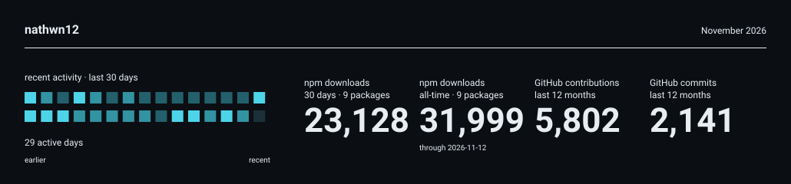

  

<h1 align="center">Hi, I’m Nathan</h1>

I’m a full-stack developer with three years of professional backend experience and frontend experience from building my own projects. I build and maintain software with AI-assisted tools as part of my daily workflow.

**Open to work** — backend and full-stack roles.

[Portfolio](https://nathwn12.github.io/) · [Resume](https://nathwn12.github.io/Nathaniel-Nikolai-Ladero-Resume.pdf) · [CV](https://nathwn12.github.io/Nathaniel-Nikolai-Ladero-CV.pdf) · [LinkedIn](https://www.linkedin.com/in/nathaniel-nikolai-l-184181261/) · [Email](mailto:nathanielnikolai.ladero@gmail.com)

## What I work with

Backend development, APIs, databases, authentication, and frontend applications. I work across TypeScript, JavaScript, C#, Rust, Python, SQL, React, Vue, ASP.NET Core, and Postgres.

## Selected projects

- [Gladius](https://github.com/nathwn12/gladius) — Rust MCP server for headless Chrome over CDP.
- [Puppet](https://github.com/nathwn12/puppet) — Rust MCP server for background-safe Windows control.
- [Chromium extensions](https://github.com/nathwn12/my-chromium-extensions) — Four browser extensions for audio and presence.
- [Arc Installer](https://github.com/nathwn12/arc-installer) — Windows installer and repair tool for the ARC icon theme.
- [sp2yt](https://github.com/nathwn12/spotify-playlist-to-youtube) — Copies a public Spotify playlist into YouTube Music without an API key.
- [Slowburn](https://github.com/nathwn12/slowburn) — Windows media player with slowed reverb and an A-B loop.

## Open source

I build and maintain projects independently, and publish packages on npm. Here are nine packages I maintain:

[gladius-mcp](https://www.npmjs.com/package/gladius-mcp) · [puppet-mcp](https://www.npmjs.com/package/puppet-mcp) · [@nathwn12/janua](https://www.npmjs.com/package/@nathwn12/janua) · [@nathwn12/oc-bifrost](https://www.npmjs.com/package/@nathwn12/oc-bifrost) · [oc-flight-deck](https://www.npmjs.com/package/oc-flight-deck) · [oc-harness-setup](https://www.npmjs.com/package/oc-harness-setup) · [oc-plugin-view](https://www.npmjs.com/package/oc-plugin-view) · [oc-talk](https://www.npmjs.com/package/oc-talk) · [rea-shim](https://www.npmjs.com/package/rea-shim)

  

  

  Built by <a href="https://github.com/nathwn12">nathwn12</a> · <a href="https://github.com/nathwn12?tab=repositories">All projects</a>

