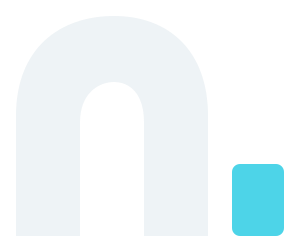

  

<h1 align="center">Hi, I’m Nathan</h1>

I’m a full-stack developer with three years of professional backend experience and frontend experience from building my own projects. I build and maintain software with AI-assisted tools as part of my daily workflow.

**Open to work** — backend and full-stack roles.

[Portfolio](https://nathwn12.github.io/) · [Resume](https://nathwn12.github.io/Nathaniel-Nikolai-Ladero-Resume.pdf) · [CV](https://nathwn12.github.io/Nathaniel-Nikolai-Ladero-CV.pdf) · [LinkedIn](https://www.linkedin.com/in/nathaniel-nikolai-l-184181261/) · [Email](mailto:nathanielnikolai.ladero@gmail.com)

## What I work with

Backend development, APIs, databases, authentication, and frontend applications. I work across TypeScript, JavaScript, C#, Rust, Python, SQL, React, Vue, ASP.NET Core, and Postgres.

## Selected projects

- [Hand](https://github.com/nathwn12/hand) — Browser automation and Windows computer use in one MCP server: headless Chrome over CDP, native UI via UIA, one Rust binary, no pointer steal.
- [Gladius](https://github.com/nathwn12/gladius) — Gives an agent a real headless browser to test, screenshot, and check layout.
- [Puppet](https://github.com/nathwn12/puppet) — Drives Windows apps without stealing focus or moving the pointer: screenshot, windows, input, and cursor over MCP.
- [oc-collections](https://github.com/nathwn12/oc-collections) — Installs OpenCode plugins, MCP servers, and CLIs one package at a time.
- [oc-templates](https://github.com/nathwn12/oc-templates) — Scaffolds an OpenCode v2 plugin with a dependency-free stdio MCP server.
- [AIMP Discord Presence](https://github.com/nathwn12/aimp-discord-presence) — Shows the current AIMP track on Discord with artist, track, and album art.
- [Potflix](https://github.com/nathwn12/potflix) — Shows the current PotPlayer title on Discord with matched artwork and episode details.
- [Pear Slowed Reverb](https://github.com/nathwn12/pear-slowed-reverb) — Runs YouTube Music in a maintained Pear Desktop fork that ships its own builds.
- [Slowburn](https://github.com/nathwn12/slowburn) — Slows tracks, adds reverb, and saves an A-B loop per song on Windows.
- [bytefry](https://github.com/nathwn12/bytefry) — Deep-fries images locally on Windows with repeat JPEG crush, a bulge, and five filters.
- [Vencord Bootstrap](https://github.com/nathwn12/vencord-bootstrap) — Installs and repairs Vencord from the official release with one PowerShell line.
- [Arc Installer](https://github.com/nathwn12/arc-installer) — Installs and repairs the ARC icon theme on Windows 10 and 11.
- [sp2yt](https://github.com/nathwn12/spotify-playlist-to-youtube) — Copies a public Spotify playlist into YouTube Music without an API key.
- [Chromium extensions](https://github.com/nathwn12/my-chromium-extensions) — Normalizes site loudness, slows playback with reverb, and reports media presence.

## Open source

I build and maintain projects independently, and publish packages on npm. Here are ten packages I maintain:

[hand-mcp](https://www.npmjs.com/package/hand-mcp) · [gladius-mcp](https://www.npmjs.com/package/gladius-mcp) · [puppet-mcp](https://www.npmjs.com/package/puppet-mcp) · [@nathwn12/janua](https://www.npmjs.com/package/@nathwn12/janua) · [@nathwn12/oc-bifrost](https://www.npmjs.com/package/@nathwn12/oc-bifrost) · [oc-flight-deck](https://www.npmjs.com/package/oc-flight-deck) · [oc-harness-setup](https://www.npmjs.com/package/oc-harness-setup) · [oc-plugin-view](https://www.npmjs.com/package/oc-plugin-view) · [oc-talk](https://www.npmjs.com/package/oc-talk) · [rea-shim](https://www.npmjs.com/package/rea-shim)

  

  <a href="https://github.com/nathwn12?tab=repositories">All projects</a>

